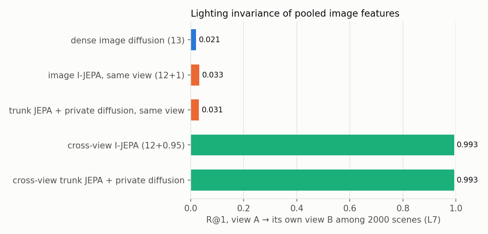
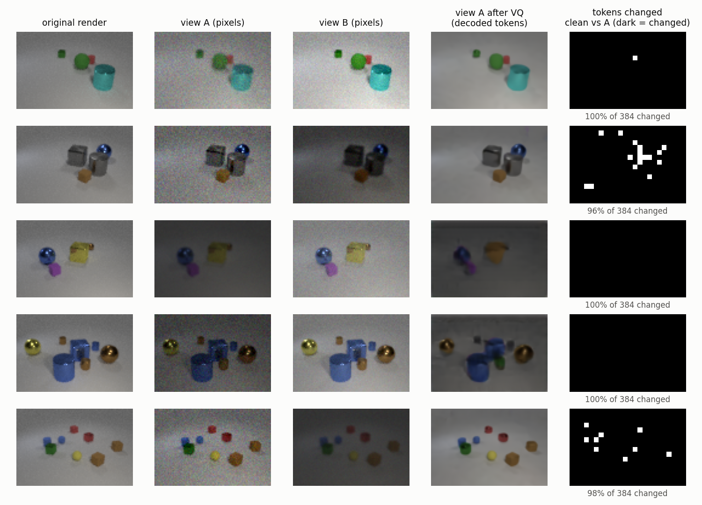
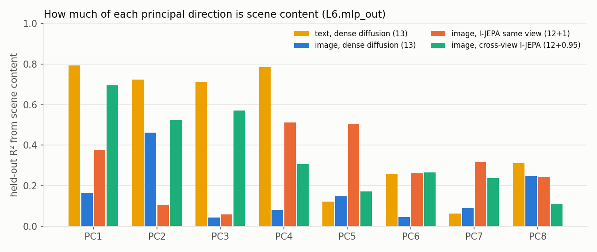
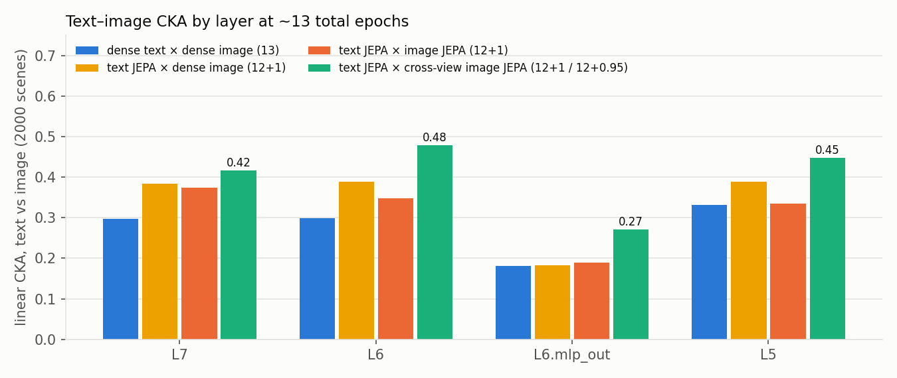
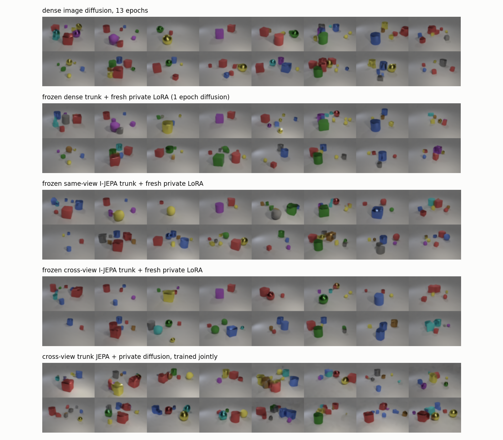

# Cross-view image I-JEPA: lighting-invariant image representations

**Question.** Our image features are dominated by appearance: lighting and exact VQ codes.
Can an image model trained only on our CLEVR images, without captions, learn a representation
whose main directions are scene content, as the text model's are? And does that help
alignment with text?

**Method in one sentence.** Starting from the dense image diffusion model at epoch 12, I-JEPA
(data2vec-style) is trained so that the student, seeing one **photometrically jittered** copy
of an image with blocks masked, predicts the EMA teacher's features of a **differently jittered**
copy of the same image.

## Summary

| Question | Answer |
|---|---|
| Does the model become lighting-invariant? | **Yes.** A relit copy of a scene is retrieved among 2000 at R@1 **0.99**, vs 0.02–0.03 for every earlier image model (§4.1). |
| Do the main directions become scene content? | **Mostly.** The lighting axis disappears. At L6.mlp_out, the content share of the top 8 PCs rises from 0.20 (dense) and 0.27 (same-view JEPA) to **0.44** (text: 0.60). |
| Is binding kept? | **Yes.** 80.6–80.9% at L7, 87% at the best layer, the same as same-view I-JEPA (§4.3). |
| Text–image CKA? | **The highest of any image model:** 0.48 at L6 and 0.27 at L6.mlp_out, vs ≤ 0.39 and ≤ 0.19 for every other combination (§4.4). |
| Hard cross-modal retrieval (CCA)? | **Unchanged vs same-view I-JEPA** (0.51–0.53). Both beat dense (0.475). |
| Unpaired image–text alignment? | **Still not usable.** The best layer reaches FOSCTTM 0.36 (chance 0.5), and R@1 stays at chance. |
| Can it still generate? | **Yes, with a separately trained private LoRA.** With the trunk frozen, a fresh private LoRA trained for 1 epoch of diffusion gives NELBO **2.16** vs 2.10 for dense diffusion, and the samples look like CLEVR (§5). Joint training with the current recipe is worse (2.80). |



## 1. Why

Three earlier findings motivated this:
- **Appearance dominates the image features.** Only 14–20% of the pooled image-feature variance
  at L6.mlp_out is explained by scene content. The VQ-code histogram explains another +0.27
  beyond content and layout. At L7, image PC2 (10% of variance) is almost purely global
  appearance (R² 0.96 from the VQ histogram, 0.03 from content).
- **The tokenizer encodes lighting into every token.** A mild brightness or contrast change
  alters **98% of the VQ tokens** of an image (figure below). For the diffusion model, the same
  scene under slightly different exposure is an almost entirely different token sequence. In
  text, a word is the same symbol whatever the context.
- **Our image geometry is hard to match.** Two of our image models align much worse without
  pairs than two of our text models at the same CKA (FOSCTTM 0.376 vs 0.046 at CKA 0.85).

DINOv2's recipe (self-distillation with photometric augmentation) is the standard way to teach
invariance. This applies the same idea inside our JEPA setup, trained only on our data.

## 2. The views: what was done to the images

No new images were rendered. For each of the **first 600,000 images** of
`train_image_only_2_5m.jsonl` (the original 1.2M block, disjoint from the retrieval eval scenes),
the existing 96×64 PNG was loaded and **two copies** were made, each with independent random
**pixel-level** transforms on the GPU (`scripts/make_augmented_views.py`):

| Transform | Range |
|---|---|
| brightness | multiply by U(0.6, 1.4) |
| contrast | scale around the image mean by U(0.6, 1.4) |
| gamma | x^γ, γ ~ U(0.7, 1.4) |
| blur | 3×3 Gaussian-like kernel, probability 0.3 |
| pixel noise | Gaussian, σ ~ U(0, 0.04) |

- **Not changed:** hue and saturation (colour is scene content), and geometry (no crops, flips
  or shifts), so token *i* covers the same image patch in both copies.
- **Tokenisation:** both copies were tokenised with the **existing** VQ-VAE
  (`outputs/vqvae_training_bs128/best.pt`) and cached as two 16×24 token grids per image
  (`outputs/image_views_cache/train_views.pt`). The tokenizer was **not** changed.
- **Portability:** the transforms are standard image augmentations and work on any image
  dataset. The cache only saves time (reading 600k PNGs from network storage took about an
  hour); the transforms and tokenisation could equally run on the fly in the training loop.



*Columns: the original render; the two jittered copies; view A after VQ encoding and decoding;
and which of the 384 tokens differ between the clean image and view A (black = changed).*

**Caveat visible in the figure:** on darker views the VQ-VAE sometimes **shifts colours** when
re-encoding. In row 3 the yellow cube decodes as orange; in row 4 a gold sphere decodes as brown.
So some view pairs also differ in *apparent colour* after tokenisation, and the objective may
partly teach the model to ignore such shifts. Binding did not drop (§4.3), but a narrower
brightness range, or a colour-faithful tokenizer, would be cleaner.

## 3. Training

### 3.1 Objective
- **Student:** sees view A, tokenised, with 2-D blocks masked: about 45% of the 16×24 grid,
  blocks of 15–20% of the image, aspect 0.75–1.5 (the `s15_t45` I-JEPA setting).
- **Teacher:** an EMA copy of the network (decay 0.999 → 0.9999 over 5000 steps) sees view B,
  clean and unmasked.
- **Loss:** data2vec layerwise. A small predictor (hidden 2× width) regresses the teacher's
  LayerNorm'd top-8 block outputs (all 8 blocks) at the masked positions, with Smooth-L1, β = 2.
- **View assignment:** per item, which view is the student's is random.
- **Code** (`train_multimodal.py`):
  - new option `data.view_cache`;
  - `CrossViewDataset` returns both views, and `CrossViewCollate` packs the teacher's view into
    `alt_input_ids`;
  - the EMA teacher forward reads `alt_input_ids` when present. Everything else is the existing
    data2vec path.

### 3.2 Runs

Both runs start from `image_dense_diffusion_2_5m_40e/epoch_011.pt` (12 epochs of dense diffusion).

| Run | Config | Trunk learns from | Generation head |
|---|---|---|---|
| `image_xview_jepa_from_dense_ep12` | `configs/image_xview_jepa_from_dense_ep12.yaml` | cross-view I-JEPA only | none (diffusion weight 0) |
| `image_xview_trunkjepa_privdiff_from_dense_ep12` | `configs/image_xview_trunkjepa_privdiff_from_dense_ep12.yaml` | cross-view I-JEPA only | private image LoRA (rank 128), trained with diffusion **at the same time**, gradient to the LoRA only |

- **Common settings:** batch 64 × 4 accumulation = 256, AdamW lr 3e-4 constant, weight decay 0,
  bf16, 8 layers, d = 384.
- **Schedule:** 4 passes over the 600k images = 9,372 optimizer steps.
- **Speed:** about 400 samples/s for the first run (1.7 h) and about 190 samples/s for the second.

### 3.3 How much training, and the "12 + 0.95" label

| | Images | Content tokens |
|---|---|---|
| dense diffusion before branching (12 epochs × 2,529,500 images) | 30.4M | 11.7B |
| cross-view JEPA (4 passes × 600,000 images) | 2.4M | 0.92B (student view; the teacher sees a second view) |

4 × 600,000 = 2.4M samples is **0.95 of one regular epoch** (2,529,500). The checkpoint
`epoch_003` is therefore "12 + 0.95" total epochs, and is compared with same-view I-JEPA "12 + 1"
and dense diffusion at epoch 13, which saw about 5% more samples. The 0.95 is a by-product of
choosing 600k images × 4 passes, not a design choice.

## 4. Results: the representation

All features are mean-pooled over the 384 image tokens and L2-normalised, from the trunk only.
They're computed on the 8000 retrieval scenes (`val_image_only.jsonl`).

### 4.1 Lighting invariance

For 2000 eval scenes, two new jittered views were made with the same augmentation and encoded.
Each scene's view A retrieves its view B among all 2000, scored by cosine on centred features
(`scripts/view_invariance.py`).

| Model (~13 epochs) | L5.mlp_out | L6.mlp_out | L6 | L7 | Mean cos(A, B), L7 |
|---|---|---|---|---|---|
| dense image diffusion | 0.036 | 0.029 | 0.024 | 0.021 | 0.03 |
| same-view image I-JEPA | 0.041 | 0.040 | 0.035 | 0.033 | 0.04 |
| same-view trunk JEPA + private diffusion | 0.039 | 0.037 | 0.029 | 0.031 | 0.04 |
| **cross-view I-JEPA** | 0.895 | **0.997** | 0.990 | **0.993** | 0.94 |
| **cross-view trunk JEPA + private diffusion** | 0.909 | 0.997 | 0.993 | 0.993 | 0.95 |

For the earlier models, a relit copy of a scene was about as far away as a random other scene.

### 4.2 What the main directions contain

Scene content here means 40 numbers per scene: object count; counts per colour, shape, material
and size; and counts per colour–shape combination. All R² values are held out (ridge fitted on
6000 scenes, scored on 2000).



| Features | Readout | Top-8 PCs, content share | PC1 / PC2 / PC3 content R² | Total content R² | + layout | + VQ histogram beyond content and layout |
|---|---|---|---|---|---|---|
| text, dense diffusion 13 | L6.mlp_out | 0.60 | 0.79 / 0.72 / 0.71 | 0.46 | +0.02 | ≈ 0 |
| image, dense diffusion 13 | L6.mlp_out | 0.20 | 0.16 / 0.46 / 0.04 | 0.15 | +0.09 | +0.27 |
| image, same-view I-JEPA 12+1 | L6.mlp_out | 0.27 | 0.38 / 0.11 / 0.06 | 0.15 | +0.08 | +0.12 |
| **image, cross-view I-JEPA 12+0.95** | L6.mlp_out | **0.44** | **0.69 / 0.52 / 0.57** | 0.23 | +0.12 | **+0.10** |
| image, dense diffusion 13 | L7 | 0.54 | 0.79 / **0.01** / 0.46 | 0.45 | +0.10 | +0.29 |
| **image, cross-view I-JEPA 12+0.95** | L7 | 0.56 | 0.75 / **0.60** / 0.57 | 0.41 | +0.15 | +0.16 |

- **The lighting axis is gone.** In dense image at L7, PC2 carries 10–13% of the variance with
  content R² 0.01. In the cross-view model, PC2 is content (0.60).
- **At L6.mlp_out the top directions now track content almost like text:** PC1–3 at
  0.69 / 0.52 / 0.57 vs text's 0.79 / 0.72 / 0.71.
- **Removing appearance alone isn't enough.** Same-view I-JEPA already cut most VQ detail (+0.12)
  but kept a non-content PC2 and PC3. The cross-view objective is what turns the top directions
  into content.
- **Similarity to ideal content features** (linear CKA, with distance RSA in brackets): dense
  image L7 0.29 (0.06) → cross-view L7 **0.41 (0.27)**.

### 4.3 Binding

Content-matched image pairs (same attributes, attached to different objects), probed with a
linear classifier (`evaluate_image_binding.py`; 397 pairs, chance 50%).

| Model | Pairwise, L7 | Strict, L7 | Best layer |
|---|---|---|---|
| dense image diffusion 13 | 80.0 | 53.3 | 83.8 (L6.mlp_out) |
| same-view I-JEPA 12+1 | 81.3 | — | 88.2 (L7.mlp_out) |
| **cross-view I-JEPA** | 80.6 | 57.3 | 87.2 (L6.mlp_out) |
| **cross-view trunk + private diffusion** | 80.9 | 56.1 | 86.9 (L6.mlp_out) |

Invariance did not cost binding. The JEPA gain over dense (84 → 87–88 at the best layer) is kept.

### 4.4 Similarity to text (CKA)

Linear CKA between text and image features on 2000 test scenes. RBF-kernel CKA and L2-distance
RSA give the same ordering (see the conversation notes; RBF stays within ±0.04).



| Text × image (total epochs) | L7 | L6 | L6.mlp_out | L5 |
|---|---|---|---|---|
| dense text × dense image (13) | 0.297 | 0.299 | 0.181 | 0.332 |
| text JEPA × dense image (12+1) | 0.383 | 0.389 | 0.183 | 0.389 |
| text JEPA × same-view image JEPA (12+1) | 0.374 | 0.348 | 0.189 | 0.335 |
| **text JEPA × cross-view image JEPA (12+1 / 12+0.95)** | **0.417** | **0.479** | **0.271** | **0.448** |

- **Across cross-view checkpoints**, CKA at L6 is 0.455 / 0.472 / 0.474 / 0.479 after
  0.24 / 0.47 / 0.71 / 0.95 epochs: most of the gain arrives early.
- **For reference:** dense × dense never exceeds 0.40 at any epoch (1–40), and text–text is
  about 0.8.

### 4.5 Retrieval and unpaired alignment with text

**Hard retrieval:** an image picks its caption among 8 captions with the same words but swapped
attributes. Chance is 0.125, with 695 test tasks. All rows use dense text, 13 epochs.

| Image model | Ridge | Whitened ridge | CCA |
|---|---|---|---|
| dense diffusion 13 | 0.214 | 0.355 | 0.475 |
| same-view I-JEPA 12+1 | 0.223 | 0.400 | 0.512 |
| same-view trunk JEPA + private diffusion | 0.224 | 0.404 | 0.521 |
| cross-view I-JEPA | 0.194 | 0.387 | 0.508 |
| cross-view trunk JEPA + private diffusion | 0.214 | 0.393 | **0.525** |

**Unpaired alignment:** the method of Schnaus et al., arXiv:2610.09411, fitted on disjoint
image and caption sets. FOSCTTM: 0 is perfect, 0.5 is chance.

| Image model × dense text 13 | Best unpaired FOSCTTM (layer) | Unpaired R@1 | Paired orthogonal ceiling, FOSCTTM / R@1 |
|---|---|---|---|
| dense diffusion 13 | 0.43–0.57 over layers | ≤ 0.003 | 0.040 / 0.15 (foreground, L6) |
| cross-view I-JEPA | 0.410 (L7), 0.413 (foreground L6) | ≤ 0.007 | 0.037 / 0.22 (foreground L6) |
| cross-view trunk + private diffusion | **0.364 (L6)**, 0.378 (L7) | ≤ 0.005 | 0.036 / 0.23 (foreground L6) |

**Image–image unpaired**, as a proxy for how matchable the image geometry is: cross-view vs dense
at L7 gives FOSCTTM **0.169** (CKA 0.70), vs 0.376 (CKA 0.85) for dense vs same-view JEPA. At L6
and L6.mlp_out there is no improvement (0.23 / 0.40 vs 0.21 / 0.41).

**Reading:**
- The image side is now much more content-like, and text–image CKA is the highest so far.
- But hard CCA doesn't move beyond what same-view JEPA already achieved.
- Unpaired image–text alignment only edges below chance; it isn't usable.
- An ideal content representation (the true scene counts) also fails to align with the text
  without pairs (CKA 0.50). So the remaining gap is largely on the **text side and in the data**
  (CLEVR's symmetries: large ↔ small, red-cube ↔ yellow-sphere, and so on), not in the image
  model.

## 5. Results: generation

Image validation loss (NELBO per token: masked cross-entropy averaged over mask rates
0.05–0.95, on 2048 clean val images with identical masks; `scripts/val_diffusion_per_modality.py`).

| Model | NELBO | Accuracy at mask 0.15 / 0.5 / 0.75 |
|---|---|---|
| dense image diffusion, 13 epochs | 2.102 | 0.45 / 0.40 / 0.33 |
| frozen dense trunk + fresh private LoRA (1 epoch of diffusion) | **2.055** | — |
| frozen same-view I-JEPA trunk + fresh private LoRA | 2.152 | — |
| **frozen cross-view I-JEPA trunk + fresh private LoRA** | **2.160** | — |
| cross-view trunk JEPA + private diffusion, **joint** (§3.2) | 2.797 | 0.28 / 0.25 / 0.21 |
| same-view trunk JEPA + private diffusion, joint | 2.320 | 0.39 / 0.36 / 0.30 |

**Frozen-trunk runs** (`configs/image_frozen_*_trunk_privdiff_1e.yaml`): the trunk is frozen and
a fresh rank-128 image LoRA (12.6M trainable parameters) is trained with plain diffusion for one
epoch on all 2.53M clean images, with a random mask rate per sample and scattered masking.



*Unconditional samples, 100 steps, random reveal order, temperature 1, same seed for every
model.* Confidence-first reveal collapses to empty floors for **every** model, dense included,
so random order is used (§6).

- **The cross-view trunk can be turned back into a generator:** a frozen cross-view trunk plus a
  separately trained LoRA reaches NELBO 2.16, 3% above dense diffusion, and its samples are
  ordinary CLEVR scenes. The same LoRA on a frozen *dense* trunk does better (2.06), so the
  invariant trunk costs a little generation quality.
- **The joint run is worse for a fixable reason:** in this trainer the private diffusion loss
  reuses the **JEPA masks** (always 45%, in large blocks) and the **jittered** student view. So
  the LoRA never practised other mask rates or clean images. Giving the diffusion loss its own
  standard masking on the clean tokens should close most of the gap; that hasn't been tested yet.

## 6. Caveats

- **Pixel-level jitter, not relighting.** Lamp positions, shadows and highlights are not
  re-rendered.
- **VQ colour shifts** on dark views (§2): some view pairs differ in apparent colour after
  tokenisation.
- **Image overlap with training.** The 8000 eval images are in the 2.53M training manifest, so the
  dense base model saw them; the view cache (first 600k images) does not contain them.
- **Small runs.** One seed; a 600k-image subset; 0.95 of an epoch of cross-view training.
- **Same-view comparisons** used full 2.53M epochs, so they had more distinct images.
- **Sampler:** confidence-first sampling collapses to empty scenes for all models at T = 1; the
  sampler needs separate attention.

## 7. Next steps

1. **The same idea for text:** train with *cross-paraphrase* views (the same scene in different
   words, which our caption generator can render without limit). This removes the wording axis.
   Then re-test text–ideal-content and image–text unpaired alignment.
2. **A shared-trunk version:** cross-view on the image side and cross-paraphrase on the text side,
   in the dropout-trained unpaired trunk.
3. **Joint generation fixed:** cross-view trunk JEPA + private diffusion with the diffusion loss
   on clean tokens with standard masking. Alternatively keep the two-stage recipe (frozen trunk +
   LoRA, §5), which already works.
4. **Views over all 2.53M images,** to remove the 0.95 and the diversity difference.
5. **Optional:** a colour-faithful, lighting-invariant tokenizer, to remove the colour shifts at
   the source.

## 8. Reproduce

```bash
# views (4 GPUs, ~1 h for 600k images), then merge
for k in 0 1 2 3; do python3 scripts/make_augmented_views.py --shard $k --num-shards 4 --gpu $k & done; wait
python3 scripts/make_augmented_views.py --merge --num-shards 4
# training
python3 train_multimodal.py --config configs/image_xview_jepa_from_dense_ep12.yaml
python3 train_multimodal.py --config configs/image_xview_trunkjepa_privdiff_from_dense_ep12.yaml
python3 train_multimodal.py --config configs/image_frozen_xviewjepa_trunk_privdiff_1e.yaml
# evaluation used here
python3 scripts/view_invariance.py --checkpoint xview=outputs/image_xview_jepa_from_dense_ep12/epoch_003.pt
python3 scripts/val_diffusion_per_modality.py --checkpoint frozen_xview=outputs/image_frozen_xviewjepa_trunk_privdiff_1e/epoch_000.pt --output OUT.json
python3 generate_image_samples.py --num-steps 100 --reveal-order random --checkpoint frozen_xview=outputs/image_frozen_xviewjepa_trunk_privdiff_1e/epoch_000.pt --output-dir OUT
python3 scripts/make_cross_view_report_figures.py
```

Feature caches: `outputs/eval_all/xret/features/xview_*`. Results:
- `outputs/eval_rosetta/` (invariance, alignment, CKA);
- `outputs/eval_img_detail/` (binding, NELBO);
- `outputs/eval_hard_xret_variants/` (hard retrieval).
